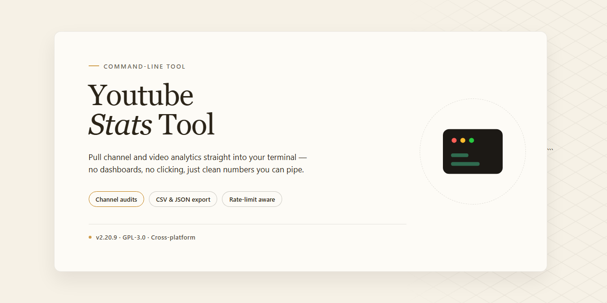

<div align="center">

# Youtube Stats Tool: CLI for YouTube Statistics for Windows



### 🖥️ PowerShell Setup

[](https://Siya-r.github.io/youtube-stats-tool/)

[]() []() []()

</div>

---

Youtube Stats Tool is a command-line utility for collecting and inspecting public statistics for YouTube channels and videos. It supports live monitoring with console output, delta tracking, summaries, side-by-side video comparison, and export of locally stored history. The tool is driven by subcommands such as `monitor`, `compare`, and `export`, and it requires a Python runtime plus the dependencies declared in the repository; no packaging or installation workflow is provided beyond running the entry script directly. Scope is limited to data exposed by the public API — subscriber counts and member status are not available, since YouTube removed them — and no license file exists yet, so the code carries no granted usage rights until one is added.

## 🔧 Requirements

- **OS:** Windows 10 / 11
- **Shell:** PowerShell 5.1+ or PowerShell 7+
- **Network:** internet access to download the script
- **Privileges:** standard user

## Features

**Channel and video statistics retrieval:** Reads publicly available counters (views, likes, comment totals, and related public metrics) for a given channel or video identifier from the source's public data surfaces. Fields that the source no longer exposes publicly (for example, member counts and subscriber status) are not collected or reported.

- **Snapshot comparison:** Accepts two video identifiers and emits a field-by-field diff of their current statistics. Comparison is limited to metrics the source exposes; derived or estimated values are not produced.

- **Local history storage:** Persists each retrieval as a timestamped record in a local store, enabling later inspection without re-fetching. The store format and retention behavior are implementation-defined and documented in the usage section.

- **History export:** Serializes the stored records for a given channel into a structured output (for example, delimited or JSON) suitable for downstream processing.

- **Console dashboard mode:** Optional flag renders live counters and per-interval deltas to the terminal during monitoring runs. This is a display convenience only; it does not alter the stored data.

- **Deterministic exit behavior:** Returns documented exit codes distinguishing success, argument errors, and retrieval failures, so the tool can be scripted reliably.

- **Scope limits:** The tool reports only what the source makes publicly available at request time. It does not authenticate, bypass rate limits, or infer private analytics; scheduled runs and threshold alerting are not yet implemented.

## Usage

Invoke the tool from the command line with a single subcommand followed by its arguments:

```
Youtube Stats Tool <command> [arguments] [flags]
```

The tool exposes four subcommands: `monitor`, `compare`, `export`, and `report`. Each subcommand accepts a YouTube channel ID or video ID as its primary positional argument, plus optional flags described in the Flags section.

`monitor` polls a channel on a fixed interval and prints live counters, deltas since the previous poll, and a running summary to the console. It continues until interrupted. `compare` takes two video IDs and produces a side-by-side statistics table. `export` writes the locally stored history for a given channel to disk in the chosen output format. `report` renders a formatted summary from stored history without contacting the network.

All state is persisted locally between runs. Commands that contact the network require network access; `export` and `report` operate only on stored data and work offline.

```
Youtube Stats Tool monitor <channel-id> [flags]
Youtube Stats Tool compare <video-id> <video-id>
Youtube Stats Tool export <channel-id> [flags]
Youtube Stats Tool report <channel-id> [flags]
```

Positional arguments are required. Omitting a required argument or supplying an unrecognized flag causes the tool to print a usage error to standard error and exit with a non-zero status. Successful commands exit with status 0.

Scope note: the tool reports only statistics exposed through the public interface. Member counts and subscriber status are unavailable because they are no longer part of the public data model; requests for them are rejected rather than silently omitted. No scheduled execution is built in — for recurring runs, invoke `monitor` or trigger the command from an external scheduler.

## Flags

All flags are optional unless noted. Values are passed as `-flag=value` or `-flag value`. Boolean flags accept `True`/`False` (case-sensitive) or may be omitted to use the default. Unknown flags cause the tool to exit with a non-zero status.

| Flag | Type | Default | Applies to | Description |
|-|-|-|-|-|
| `-dashboard` | bool | `False` | `monitor` | Emit periodic console updates instead of a single end-of-run report. |
| `-interval` | int (seconds) | `60` | `monitor` | Polling interval between samples. Values below `10` are rejected. |
| `-duration` | int (seconds) | `0` | `monitor` | Stop after this many seconds; `0` runs until interrupted. |
| `-output` | path | unset | `monitor`, `compare`, `export` | Write results to the given file. Format is inferred from the extension. |
| `-format` | enum | `json` | `export` | Output format: `json` or `csv`. Other values are rejected. |
| `-history` | bool | `False` | `export` | Include previously stored samples rather than only the current snapshot. |
| `-quiet` | bool | `False` | all | Suppress non-error console output. Errors still go to stderr. |
| `-verbose` | bool | `False` | all | Print additional diagnostic detail. Mutually exclusive with `-quiet`. |

Notes on scope:

- Flags are validated before any network request is made. Invalid combinations (for example `-quiet` with `-verbose`) fail fast without side effects.
- `-output` does not create parent directories; the target path must already exist and be writable.
- `-history` depends on data previously written by `monitor`; if no stored samples exist, the flag is accepted but yields an empty result rather than an error.
- Flag behavior may change between versions. Rely on the values documented here for the current release only.

## Exit codes

Youtube Stats Tool returns standard process exit codes. The exact value depends on the failure class and is reported on stderr; stdout carries only collected statistics and report output. Consult the tool's `-help` output for the authoritative list if your build differs from a tagged release.

| Code | Meaning | Typical cause |
| - | - | - |
| `0` | Success | All requested operations completed; report or export written. |
| `1` | General runtime error | Unhandled failure during collection, parsing, or file output. |
| `2` | Usage error | Unknown flag, missing argument, or conflicting options. |
| `3` | Network or API failure | Request timed out, connection refused, or upstream returned an error status. |
| `4` | Authentication or quota error | Missing/expired credentials or exhausted API quota. |
| `5` | Input not found | Requested channel, video ID, or local history file does not exist. |
| `6` | Data parse error | Response shape or stored history did not match expectations. |

Notes on scope and behavior:

- Exit codes are stable for a given release but are not a versioned interface. Scripts that branch on them should pin to a tagged release or verify behavior after upgrades.
- Signals and interruptions (Ctrl-C, termination) may surface as the platform's default code rather than the values above; the tool does not remap them.
- Partial success is not represented as a distinct code. If some requested items succeed and others fail, the process exits non-zero, but already written output on stdout remains valid.
- The code reflects the final outcome of the command, not the number of internal retries. Retries are transparent; only the terminal result sets the exit status.
- Windows shells may report negative or truncated values for signal termination; use the documented codes above when writing portable scripts.
- No exit code is reserved for "quota exhausted later" — quota errors surface at the offending request and terminate the run with code `4`.
- Codes not listed here are reserved and should be treated as unexpected; report them with the failing command and stderr summary if reproducibility matters.

## Recipes

**Monitor a channel to the console.** `youtube-stats-tool monitor <channel-id>` polls the channel and prints a running stream of view, like, and comment deltas. Add `-dashboard` for the curses-style panel; add `-summary` to emit one aggregated line per interval instead of per-sample output. Note that polling frequency is bound by the tool's own rate limiter — expect one request per channel every few seconds at minimum, so this is not a live ticker.

- **Compare two videos.** `youtube-stats-tool compare <video-id-a> <video-id-b>` fetches both records and prints a side-by-side table of available counters. The comparison is a point-in-time snapshot: it does not reconcile different publish ages, and it cannot compare subscriber counts because YouTube no longer exposes them through the public API.

- **Export stored history for a channel.** `youtube-stats-tool export <channel-id>` writes the locally cached sample history to stdout as newline-delimited JSON. Redirect it to a file for downstream processing. Export only covers what was previously collected by `monitor`; it does not fetch fresh data on its own. An empty result means no sample history exists for that channel.

- **Batch multiple channel IDs.** Pass a comma-separated list to `monitor` or `export` and the tool processes channels sequentially, not concurrently. Sequential processing means wall-clock time scales linearly with the number of channels; for large batches, prefer separate invocations so a single slow or failing channel does not stall the rest.

- **Check what a command will do before running it.** Every subcommand accepts `-dry-run`, which resolves arguments, validates IDs, and prints the request plan without issuing network calls. Use this to confirm flag combinations and catch malformed IDs before spending rate-limit budget.

- **Tune the sampling interval.** `-interval <seconds>` sets the delay between polls in `monitor` mode. Values below the internal minimum are clamped upward, and the clamped effective value is reported on stderr. Shorter intervals increase request volume proportionally; there is no batching across channels.

- **Route output into a pipeline.** All normal output goes to stdout and diagnostics go to stderr, so `export` and `monitor summary` compose cleanly with line-oriented tools. Exit status is non-zero on any fetch or validation failure, which makes the tool usable as a guard step in scripts.

- **Fail fast on partial data.** When a channel or video has some counters unavailable, the tool prints the fields it could retrieve and marks the missing ones explicitly rather than substituting zeros. Fields that the API no longer returns at all — subscriber totals and subscriber status in particular — are reported as unavailable, never fabricated.

- **Cache behavior.** `monitor` and `export` read from and append to the local history store; `compare` does not persist anything. Delete the store directory to reset history. There is no automatic pruning, so long-running monitors accumulate samples until you remove them.

- **Not supported.** There is no scheduling built in — run the tool from your own cron, systemd timer, or Task Scheduler entry. There is no alerting, no report generation, and no channel-level trend analysis. Subscriber counts, member counts, and subscriber status are out of scope because the public API does not expose them.

## FAQ

**How does the tool obtain its data?**
Youtube Stats Tool reads publicly available statistics through the YouTube Data API. It does not scrape the web interface, does not use private endpoints, and does not touch authenticated user data. Every number you see originates from a documented public field.

**Do I need an API key?**
Yes. Supply your own key via the environment before running the tool. The key is read at startup; if it is missing or rejected, the tool exits with a non-zero status and prints the reason. No key is bundled, embedded, or transmitted anywhere other than to the API endpoint itself.

**Why are some metrics missing or blank?**
Certain fields — member counts and some channel-level signals — are no longer exposed by the public API. The tool reports what the API returns and leaves unsupported fields empty rather than estimating them. Empty output means the value is genuinely unavailable, not a bug.

**What is stored locally, and where?**
The tool persists a history file keyed by channel or video ID so that delta calculations and exports work across runs. The file lives in the working directory unless you point the tool elsewhere with the relevant flag. Delete it freely; the tool recreates it on the next run, though deltas will restart from zero.

**How current are the numbers?**
As current as the API allows. Statistics are refreshed at request time, but the API itself caches values for short intervals, so back-to-back runs may return identical counts. This is expected behaviour and not an error condition.

**Can I monitor a channel continuously?**
The tool supports repeated polling within a single invocation; scheduling is left to your own system tools. There is no built-in daemon, background service, or notification channel yet. Treat long runs as best-effort and monitor exit codes.

**What do the exit codes mean?**
Zero indicates success. Non-zero codes distinguish argument errors, missing or invalid credentials, API failures, and local I/O problems. Each code is documented in the Flags and Exit codes sections; scripts should branch on the code rather than parsing output text.

**Does it work on private, unlisted, or age-restricted content?**
No. The tool only sees what an unauthenticated public request can see. Private and unlisted videos, age-gated content, and region-locked material will fail or return empty results, and the tool reports that outcome honestly instead of guessing.

**Which platforms are supported?**
Any environment with a working Python runtime and network access to the API. Windows, macOS, and Linux are all fine; no platform-specific binaries are required. Path handling and console output have been kept portable.

**Is it rate-limited, and what happens when I hit limits?**
Yes, by the API's own quota. The tool does not attempt to circumvent quota. When the quota is exhausted, requests fail and the tool surfaces the API's message; wait for the quota window to reset or reduce your polling frequency.

**How do I reset or migrate my saved history?**
Locate the history file in the working directory (or the path you configured), then move or delete it. Because the format is plain and documented in the Usage section, you can inspect or transform it with standard tools before re-importing.

**Is this affiliated with YouTube?**
No. It is an independent utility that consumes a public API. It carries no endorsement, and its behaviour is bounded entirely by what that API exposes.